<picture>
  <source media="(prefers-color-scheme: dark)" srcset="https://raw.githubusercontent.com/Anonymity-0/Anonymity-0/garden-output/chiikawa-dark.svg">
  
</picture>

### Hello World！ 👋

<!--
**Anonymity-0/Anonymity-0** is a ✨ _special_ ✨ repository because its `README.md` (this file) appears on your GitHub profile.

Here are some ideas to get you started:

- 🔭 I’m currently working on ...
- 🌱 I’m currently learning ...
- 👯 I’m looking to collaborate on ...
- 🤔 I’m looking for help with ...
- 💬 Ask me about ...
- 📫 How to reach me: ...
- 😄 Pronouns: ...
- ⚡ Fun fact: ...
-->
- 🌱 I’m currently learning JAVA
- 💬 Stay hungry Stay foolish
- 📫 How to reach me: 
  - 📧:gagaq.0716@gmail.com
- ⚡ Fun: 🏸
